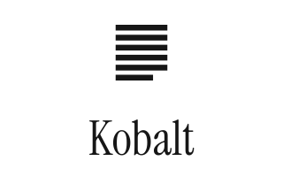

  

**Kobalt is an experimental EPUB reader with a CREngine renderer and a Qt reading interface, with a focus on speed and an excellent user experience.**

The reader app and the UI stands on its own, and as such is planned to be ported to various platforms. On Android, it runs as a standalone app, and on Kobo it runs as a modification inside of Kobo's own OS.

### How does the Kobo version work?

The Kobo version opens DRM-free EPUBs, including DRM-free books purchased from Kobo. Kobo's OS still handles dictionaries, reading progress and reading sessions. You can choose Kobalt as your default reader or open a book with it from the book's long-press menu.

Protected books, previews, PDFs and other unsupported formats show “Opening in built-in reader” and continue in Kobo's regular reader app.

> [!NOTE]
> This project intentionally contains no service for loading decrypted resources from protected books. Books with any kind of DRM are automatically opened by the built-in reader.

### What about the other versions?

The source code is included, but the Android and Mac versions are not ready for general release yet.

- The Android version opens unprotected EPUBs through the document picker or Open with. It keeps reading progress and bookmarks locally. See [Android setup, building, signing and limitations](android/README.md) for more information.

- The macOS development app uses the same reader in a resizable window for testing books. For more information, take a look at [the documentation](docs/development.md#macos).

## Compatibility and installation

### Install on Kobo

> [!IMPORTANT]
> Keep a backup of your books and reading data before testing, no matter whether you use the website or not. I have done my best to make Kobalt as stable and safe as possible, but you should always have a backup, just to be safe.

#### Automatic installation via Chrome

The easiest way is via [the website](https://kobalt.nicoverbruggen.be). Click on **Install or remove Kobalt** and you should follow the steps on the website. The website will check if your device is compatible.

#### Manual installation

There are two installation packages: one for the firmware 4.x line, and one for the latest beta, which is currently at version 6.x. Choose the right one for your Kobo, so check what software version you have installed first!

| Package | Firmware | Latest at time of testing |
|---|---|---|
| `kobalt-qt5.zip` | 4.38.21908 and later 4.x | Stable Kobo release (4.38 or 4.45)
| `kobalt-qt6.zip` | 5.18 and later 5.x, and 6.x | Beta Kobo release (6.0)*

_(*) Due to how software updates work on Kobo OS 6, you may need a future version of [NickelModManager](https://github.com/nicoverbruggen/NickelModManager) to avoid needing to reinstall mods._

1. Connect your Kobo over USB and extract the ZIP package on your computer. Show hidden files so you can see `.adds` and `.kobo`.
2. Copy the complete `.adds` folder to the root of the Kobo drive. Merge it with the existing folder and replace matching package files. Keep other apps, settings and reading data.
3. Copy the complete `.kobo` folder from the extracted package to the same drive root. Merge it with the existing folder. Firmware 4 uses `.kobo/KoboRoot.tgz`; firmware 5 and 6 use `.kobo/Kobo.tgz`.
4. Eject the Kobo safely, disconnect USB and let it install the update.

Copy every file supplied in the ZIP, keeping its folder path. Copy `.adds` before `.kobo` so the assets are present when the update starts. Do not copy only the `.tgz` file or unpack it yourself. Kobalt creates its support files and installation marker on first startup.

## Issues and contributions

This repository contains Kobalt's public source. Report bugs via the Discussions tab here on GitHub. Issues are reserved for contributors for managing the project.

If you have a sample book that exhibits an issue, please attach it if you are permitted to do so, this can help find issues more quickly.

## Acknowledgements

For a complete list, please check out [the acknowledgements](ACKNOWLEDGEMENTS.md) document.

### KOReader

[KOReader](https://koreader.rocks/) is an amazing piece of software, and some of its source is used (the renderer, for example) to make this project possible. A big thanks to the contributors of KOReader. If you feel like Kobalt is too limited in its features, you may want to give it a shot. 

## Disclaimers

1. This project is not affiliated with Rakuten Kobo Inc. or the tolino alliance. Kobo and tolino are trademarks of their respective owners.
2. The creator of Kobalt does not encourage or endorse the removal of DRM, and Kobalt does not allow for it. Support your favorite author by purchasing their books.
3. This project was made with the help of agentic engineering with models from OpenAI and Anthropic. I would not have been able to make this project otherwise. Instructions intended for agents are included in [AGENTS.md](AGENTS.md).

## License

Like KOReader, this project is available under an open source license.

Kobalt's own source code uses the MIT license in [LICENSE](LICENSE). CREngine patches use GNU GPL v2 or later, and Qt patches use Qt's licenses. Third-party code and assets retain their own licenses and notices in `resources/notices/`, `toolchains/nickelhook-qt6/` and `toolchains/qt6/source/LICENSES/`.

The combined package includes GPL and AGPL code and is distributed under GNU AGPL v3, without warranty. Binary releases include the corresponding source and dependency sources.
